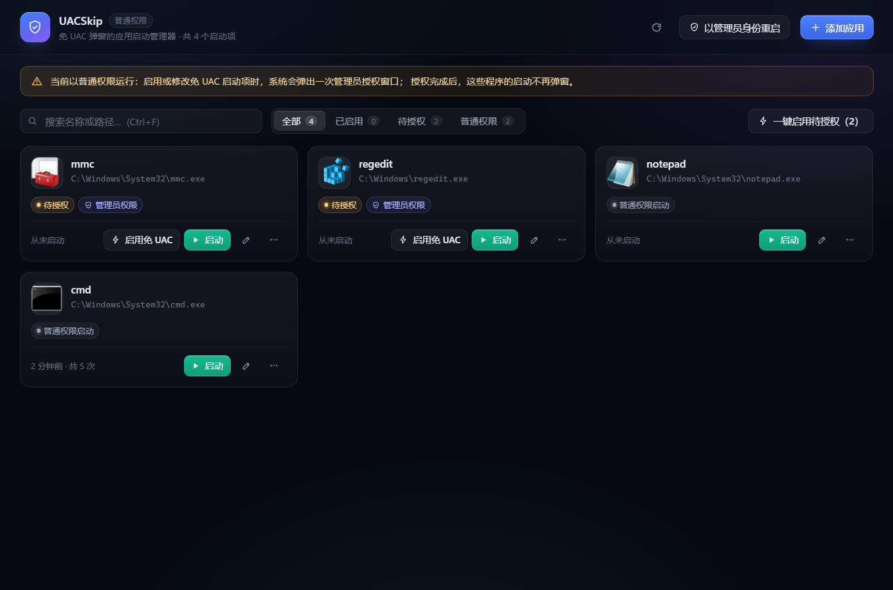

# UACSkip · 免 UAC 弹窗的应用启动管理器

一个基于 **Tauri 2 + React 19 + Rust** 的 Windows 桌面工具：用可视化的方式管理那些
「需要管理员权限、每次启动都弹 UAC」的程序，让它们之后可以**双击直接启动、不再弹窗**。



---

## 功能

| 功能 | 说明 |
| --- | --- |
| 可视化列表 | 卡片式展示所有已托管的程序，显示图标、路径、权限模式、启动次数与最近启动时间 |
| 资源管理器选择 | 点击「添加应用」打开系统原生文件对话框选择 `.exe` / `.bat` / `.cmd` |
| 拖拽添加 | 直接把可执行文件拖进窗口即可添加 |
| 免 UAC 启动 | 自动为程序注册「最高权限」计划任务，之后启动不再弹出 UAC 授权窗口 |
| 自动识别权限需求 | 读取 PE 内嵌清单（`requireAdministrator` / `highestAvailable`），自动选择启动方式 |
| 搜索与筛选 | 按名称/路径搜索，按「已启用 / 待授权 / 普通权限」筛选 |
| 参数与工作目录 | 可为每个程序单独配置启动参数、工作目录 |
| 启动方式切换 | 免 UAC 提权启动 ↔ 普通权限启动，随时切换 |
| 状态实时校验 | 每次刷新都会核对计划任务是否真实存在，文件被移动/删除会明确提示 |
| 一键批量授权 | 多个待授权项可以一次性完成授权，只弹一次 UAC |
| 桌面快捷方式 | 为已启用的程序生成「双击即启动、不弹 UAC」的桌面快捷方式（图标沿用原程序） |

## 免 UAC 的原理

Windows 上「以管理员身份运行」必然要经过 UAC 同意。真正能绕开弹窗的稳定做法，
是**先把提权意图固化到系统里**：

1. 在**任务计划程序**中注册一个任务，设置
   - 主体：当前登录用户，登录类型 `InteractiveToken`（在用户会话中运行，能看到界面）
   - 运行级别：`HighestAvailable`（最高权限）
   - 触发器：**无**（只能被手动触发，不会自己乱跑）
   - 其它：允许多开、电池下也运行、不限执行时长
2. 之后通过 `IRegisteredTask::Run` 触发该任务，程序即以管理员权限在用户会话中启动，
   **不会出现 UAC 窗口**。

注册这样的任务本身需要一次管理员权限，所以：

- UACSkip 默认以**普通权限**运行；
- 当你第一次「启用免 UAC」时，程序会用一个**提权助手进程**（`--uacskip-task-helper`）
  请求一次 UAC 授权，由它完成注册后立即退出；
- 一次授权可以批量处理多个程序；也可以在标题栏点「以管理员身份重启」，
  之后的所有操作都不再弹窗。

> 所有计划任务都命名为 `UACSkip-xxxxxxxxxx`，可以在「任务计划程序」中直接查看和删除。

## 为什么双击原 exe 仍然弹 UAC

UAC 弹窗由 **exe 自身的清单**决定，而不是由「谁启动它」决定。资源管理器作为父进程创建进程时，
Shell 读到目标 PE 里的 `requestedExecutionLevel`：

```xml
<requestedExecutionLevel level="requireAdministrator" uiAccess="false"/>
```

只要这个声明还在，任何走 Shell 的启动方式（双击、开始菜单、快捷方式、拖到任务栏）都会先弹同意框。
UACSkip 注册的计划任务是**另一条独立的启动通道**：由任务计划程序以最高权限令牌直接创建进程，
不经过 Shell 的提权检查，所以不弹窗。两条通道互不相干，原 exe 的清单不会被改动。

### 想要「双击就启动」，用桌面快捷方式

在卡片菜单里选「创建桌面快捷方式」，会生成一个指向静默触发模式的 `.lnk`：

```
uac-skip.exe --run UACSkip-a1b2c3d4e5
```

- 图标沿用目标程序自己的图标，看起来和原快捷方式一致
- 双击它 = 启动原程序，**不弹 UAC**（发布版是 GUI 子系统，不会闪黑框）
- 可以拖到任务栏/开始菜单，或替换掉原来那个会弹窗的快捷方式
- 若任务已被删除，双击时会弹一个提示框而不是静默失败

> 真正的「原 exe 双击不弹窗」只能靠改注册表劫持进程创建（IFEO 之类），
> 那是恶意软件常用的 UAC 绕过手法，需要写 HKLM、会被安全软件标记，
> 且会让系统里所有启动该程序的路径都静默提权，本项目不会这么做。

## 技术栈

- **前端**：React 19 · TypeScript 5.9 · Vite 7，无 UI 框架，手写 CSS 设计系统
- **后端**：Rust 2021 · Tauri 2.12 · `windows` 0.62（原生 Win32 / COM 调用，无 shell 转发）
- **图标提取**：`IShellItemImageFactory` 取 256px 图标 → GDI `GetDIBits` → RGBA → 缩放 → PNG
- **权限探测**：`LoadLibraryExW(LOAD_LIBRARY_AS_DATAFILE)` + `FindResourceW(RT_MANIFEST)` 解析应用清单

后端没有调用 `schtasks.exe` 或 PowerShell，全部通过 Task Scheduler 的 COM 接口完成，
启动开销小、行为可控。

## 目录结构

```
uac-skip/
├─ src/                     前端
│  ├─ App.tsx               主界面（列表、筛选、拖放、动作编排）
│  ├─ api.ts                命令封装 + 文件选择框
│  ├─ types.ts              与 Rust 对应的类型
│  ├─ styles.css            设计系统
│  └─ components/           卡片、编辑框、确认框、Toast、图标
├─ src-tauri/
│  ├─ src/
│  │  ├─ lib.rs             应用装配与命令注册
│  │  ├─ commands.rs        业务命令（增删改查、启动、批量注册）
│  │  ├─ task.rs            任务计划程序 COM 封装 + 单元测试
│  │  ├─ elevate.rs         UAC 提权（ShellExecuteEx "runas"）
│  │  ├─ helper.rs          提权助手协议（base64 载荷 + 结果文件）
│  │  ├─ cli.rs             静默触发模式（--run，供桌面快捷方式调用）
│  │  ├─ shortcut.rs        桌面快捷方式生成（IShellLink）
│  │  ├─ icons.rs           图标提取、清单解析
│  │  ├─ model.rs           数据模型
│  │  └─ store.rs           JSON 持久化（便携目录 + 原子写入）
│  ├─ examples/task_probe.rs  运行时探针（诊断用）
│  └─ icons/                应用图标（由脚本生成）
├─ scripts/make-icons.mjs   零依赖图标生成器（PNG 编码 + ICO 打包）
├─ .github/workflows/release.yml  发版流水线（release: 提交触发）
└─ docs/                    截图
```

## 开发

```bash
pnpm install          # 安装依赖
pnpm app:dev          # 启动开发模式（Vite + Tauri）
```

其他命令：

```bash
pnpm build            # 类型检查 + 前端构建
pnpm icons            # 重新生成应用图标
cargo test --manifest-path src-tauri/Cargo.toml --lib   # 后端测试
```

## 打包

```bash
# 单文件绿色版（推荐，也是 CI 发布的产物）
pnpm exec tauri build --no-bundle
# 产物：src-tauri/target/release/uac-skip.exe

# 带安装包的完整打包
pnpm app:build
# 产物：src-tauri/target/release/bundle/nsis/UACSkip_0.1.0_x64-setup.exe
```

`--no-bundle` 只产出单个 exe，前端的 HTML/CSS/JS 已经内嵌在其中，
把它拷到任何位置双击即可运行，不需要安装、不需要伴随文件。

## 数据存储

配置**存放在 exe 所在目录**，写 portable 的初衷就是「拷走整个文件夹，数据跟着走」：

```
<exe 所在目录>\apps.json
```

- 启动时会先探测该目录是否可写；若不可写（例如装在 `Program Files` 且无权限），
  才回退到 `%APPDATA%\com.uacskip.desktop\apps.json`，界面上会显示实际使用的路径。
- 文件损坏时会自动备份为 `apps.json.broken` 并重建，不会静默丢数据。
- 旧的用户目录配置在首次以便携模式启动时会自动迁移过来。

## 发布流程

仓库带有 GitHub Actions 工作流 `.github/workflows/release.yml`，用提交信息触发发版：

```bash
git commit -m "release: v0.0.1"
git push
```

只要提交信息以 `release:` 开头，CI 就会：

1. 从提交信息里解析版本号（`release: v0.0.1` → `v0.0.1`），同步写入
   `package.json`、`src-tauri/tauri.conf.json`、`src-tauri/Cargo.toml`；
2. 跑后端测试，构建单文件绿色版 `UACSkip-<版本>-x64-portable.exe`；
3. 计算 SHA256；
4. 自动找到**上一个 Release**，把 `上一个 Release..本次提交` 之间的所有提交
   （排除以 `release:` 开头的提交）汇总成发布说明；
5. 创建 GitHub Release 并上传 exe 与校验和。

也可以在 Actions 页面手动触发（`workflow_dispatch`），填一个版本号即可。

> 版本号必须形如 `v0.0.1` 或 `0.0.1`（支持 `v1.0.0-beta.1` 这类预发布）；
> 若标签已存在会直接失败，避免覆盖历史发布。

## 已知限制

- 仅支持 Windows 10 / 11（依赖任务计划程序 COM 接口与 WebView2）。
- 只有 `.exe` / `.bat` / `.cmd` 可作为目标；`.lnk` 快捷方式请先解析出真实路径。
- 免 UAC 启动的程序会以**管理员权限**运行，与 UAC 弹窗后点「是」的效果一致；
  若程序本身不需要管理员权限，建议用「普通权限启动」以免过度提权。
- 若系统策略（如 AppLocker / 组策略）禁止创建最高权限计划任务，注册会失败并给出明确提示。

## 安全说明

- 程序不会修改系统文件、不写注册表、不驻留后台服务，只在你确认时创建/删除计划任务。
- 提权助手只接受本次调用生成的一次性载荷，执行完指定动作后立即退出。
- 所有任务都可通过「移除」按钮或 Windows「任务计划程序」彻底删除。
